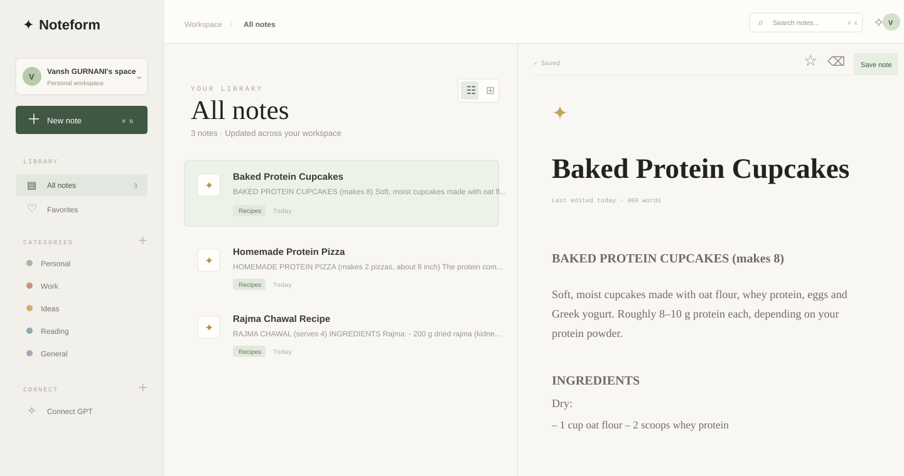

# Noteform

Noteform is a calm, Notion-inspired personal notes workspace. Users can create, edit, search, categorize, bookmark, and delete notes from a Next.js interface. A FastAPI service owns authentication and data access, while an MCP endpoint lets an authorized GPT-compatible client search and write notes.



> The image above is the repository UI reference preview for the current product direction. The live interface is rendered by `frontend/`.

## Product capabilities

- Personal workspaces with user-scoped notes.
- Workspace records and membership foundations for future collaboration.
- Workspace-owned default and custom categories.
- Note creation, editing, deletion, category filtering, search, and bookmarks.
- Nested pages with a navigable page tree in each personal workspace.
- Responsive Notion-inspired two-pane workspace UI.
- JWT session authentication for the web application.
- HTTP-only web sessions with JWT compatibility for existing clients.
- Permanent, user-scoped MCP API tokens stored as SHA-256 hashes.
- OAuth 2.1 discovery, dynamic client registration, authorization-code + PKCE flow, and refresh tokens for hosted MCP clients such as ChatGPT.
- MCP tools for `search_notes`, `get_note`, `create_note`, and `list_bookmarks`.
- MongoDB persistence with Docker volume storage.
- Public HTTPS MCP access through the hosting provider's web service.
- Mongo-backed background jobs with a Compose worker for asynchronous insights.

## Architecture at a glance

```text
Browser ──HTTPS──> Next.js frontend
                      │ REST + JWT
                      ▼
                 FastAPI API ──> MongoDB
                      ▲
                      │ MCP + OAuth 2.1
                      │
              ChatGPT / MCP client
```

The frontend and backend are separate services. In production, the backend web service is directly reachable over HTTPS, so MCP clients can use its `/mcp` endpoint without a tunnel.

See the [product roadmap](docs/PRODUCT-ROADMAP.md) for user-facing features and
the [architecture roadmap](docs/ARCHITECTURE-ROADMAP.md) for technical
foundations and operations.

## Repository layout

```text
.
├── backend/
│   ├── app/
│   │   ├── auth.py          # Password hashing, JWT, MCP/OAuth token helpers
│   │   ├── config.py        # Environment-backed settings
│   │   ├── database.py      # MongoDB client and collection access
│   │   ├── main.py          # FastAPI routes and MCP JSON-RPC endpoint
│   │   ├── schemas.py       # Request validation models
│   │   └── serializers.py   # MongoDB response serialization
│   ├── Dockerfile
│   └── requirements.txt
├── frontend/
│   ├── app/                 # Next.js App Router pages and workspace UI
│   ├── lib/api.ts           # Browser API client
│   └── Dockerfile
├── docs/
│   ├── ARCHITECTURE-ROADMAP.md
│   └── assets/noteform-workspace.svg
├── docker-compose.yml
├── .env.example
└── package.json
```

The old Express backend and legacy React application are no longer part of the runtime.

## Requirements

- Docker Desktop, Colima, or another Docker daemon.
- `docker-compose` v2 or v5. This project currently uses the hyphenated command because it is available in the development environment.
- Node.js 20+ only if running frontend commands outside Docker.
- Python 3.12+ only if running the API outside Docker.

## Quick start with Docker

```bash
cp backend/.env.example backend/.env
cp frontend/.env.example frontend/.env
npm run docker:up
```

Open:

- Frontend: [http://localhost:3000](http://localhost:3000)
- FastAPI Swagger UI: [http://localhost:8000/docs](http://localhost:8000/docs)
- API health: [http://localhost:8000/health](http://localhost:8000/health)
- Metrics: [http://localhost:8000/metrics](http://localhost:8000/metrics) locally, or with `X-Metrics-Token` when configured.

Stop the stack:

```bash
npm run docker:down
```

MongoDB data is stored in the named `mongo_data` Docker volume. The `docker:up` script starts Colima and sets `DOCKER_BUILDKIT=0`, so the project can build on machines where the optional Buildx CLI plugin is missing.

## Environment configuration

Copy the relevant `backend/.env.example` or `frontend/.env.example` file to a local `.env` file and replace development values before sharing the service publicly.

| Variable | Purpose |
| --- | --- |
| `JWT_SECRET` | Signs web-session JWTs. Use a long random value. |
| `MCP_PUBLIC_URL` | Public MCP resource URL, normally `https://your-api.onrender.com/mcp`. |
| `MCP_API_KEY` | Optional server-to-server MCP key. Prefer user-generated tokens for user-scoped access. |
| `MCP_USER_ID` | User ID paired with the optional global `MCP_API_KEY`. |

Never commit `.env`, JWT secrets, MCP tokens, or database credentials. If a credential was ever committed, revoke or rotate it even after removing it from the working tree.

## Render deployment

Render can build the existing backend Dockerfile and host the frontend as a Node.js web service. Use MongoDB Atlas or a Render-hosted MongoDB private service; the local Compose MongoDB volume is not a production database.

1. Push the repository to GitHub or another Git provider.
2. Create a MongoDB database. Copy its connection string and make sure the database accepts connections from Render. Use a strong database user and password.
3. In Render, create a **Web Service** for the backend from the repository:

   - Runtime: **Docker**
   - Root directory: `backend`
   - Health check path: `/health`
   - Environment variables:

     ```dotenv
     MONGO_URI=<mongodb-connection-string>
     MONGO_DB=noteform
     JWT_SECRET=<long-random-secret>
     CORS_ORIGINS=https://<frontend-service>.onrender.com
     MCP_PUBLIC_URL=https://<backend-service>.onrender.com/mcp
     MCP_API_KEY=
     MCP_USER_ID=
     ```

   Render supplies `PORT`; the backend container uses it automatically.

4. Create a second Render **Web Service** for the frontend:

   - Runtime: **Node**
   - Root directory: `frontend`
   - Build command: `npm ci && npm run build`
   - Start command: `npm start`
   - Environment variable:

     ```dotenv
     NEXT_PUBLIC_API_URL=https://<backend-service>.onrender.com
     ```

5. Replace `<frontend-service>.onrender.com` in the backend's `CORS_ORIGINS` value with the actual frontend URL, save, and redeploy the backend.
6. Verify the deployment:

   ```text
   https://<backend-service>.onrender.com/health
   https://<backend-service>.onrender.com/.well-known/oauth-protected-resource
   https://<frontend-service>.onrender.com
   ```

Use `https://<backend-service>.onrender.com/mcp` as the MCP URL. If you add a custom domain, update `MCP_PUBLIC_URL`, `CORS_ORIGINS`, and the MCP client configuration to use that stable domain, then redeploy the backend.

See Render's [Docker deployment](https://render.com/docs/docker), [web service guide](https://render.com/docs/web-services), and [environment variable guide](https://render.com/docs/configure-environment-variables) for the current dashboard fields.

## Connecting an MCP client

### Generic MCP clients

1. Register and sign in at [http://localhost:3000](http://localhost:3000).
2. Open **Connect GPT** in the workspace sidebar.
3. Create a permanent MCP token. It is shown only once.
4. Configure the client with `MCP_PUBLIC_URL` and send either:

   ```http
   X-MCP-API-Key: nf_mcp_<token>
   ```

   or:

   ```http
   Authorization: Bearer nf_mcp_<token>
   ```

The token does not expire, is scoped to one Noteform user, and is stored only as a hash. Creating a replacement invalidates the previous token.

### ChatGPT or another OAuth MCP client

Use the public HTTPS MCP resource URL, for example:

```text
https://mcp.example.com/mcp
```

The server publishes protected-resource metadata, authorization-server metadata, dynamic client registration, and PKCE authorization endpoints. The client should discover the OAuth flow, open Noteform’s sign-in page, and request scoped access. The web API token is not used as an OAuth client secret.

## API and MCP routes

| Method | Route | Purpose |
| --- | --- | --- |
| `GET` | `/health` | Basic service check |
| `GET` | `/health/live` | Process liveness check |
| `GET` | `/health/ready` | MongoDB readiness check |
| `GET` | `/metrics` | Prometheus-style request counters |
| `POST` | `/jobs/insights` | Queue an asynchronous insights calculation |
| `GET` | `/jobs/{id}` | Read an owned job status/result |
| `POST` | `/auth/register` | Create a web user and return a JWT |
| `POST` | `/auth/login` | Authenticate a web user |
| `GET` | `/auth/me` | Return the current web user |
| `POST` | `/auth/logout` | Revoke the current browser session |
| `GET` | `/workspaces` | List the current user’s workspaces |
| `POST` | `/workspaces` | Create a workspace |
| `GET` | `/workspaces/{id}` | Read an authorized workspace |
| `GET` | `/workspaces/{id}/members` | List workspace members |
| `POST` | `/workspaces/{id}/invites` | Create an owner-controlled invite token |
| `POST` | `/workspaces/invites/{token}/accept` | Accept a workspace invite |
| `GET` | `/categories` | List workspace categories |
| `POST` | `/categories` | Create a category |
| `DELETE` | `/categories/{id}` | Delete a custom category |
| `POST` | `/auth/mcp-token` | Create or replace a permanent MCP token |
| `DELETE` | `/auth/mcp-token` | Revoke the current MCP token |
| `GET` | `/notes` | Search and filter notes with cursor pagination |
| `GET` | `/notes/export?format=json|markdown` | Export up to 100 notes |
| `POST` | `/notes/import` | Import up to 100 notes |
| `POST` | `/notes` | Create a note |
| `PATCH` | `/notes/{id}` | Update a note |
| `GET` | `/notes/{id}/revisions` | List note revisions |
| `POST` | `/notes/{id}/revisions/{version}/restore` | Restore a note revision |
| `POST` | `/notes/{id}/bookmark` | Toggle a bookmark |
| `DELETE` | `/notes/{id}` | Delete a note |
| `POST` | `/mcp` | MCP JSON-RPC endpoint |
| `GET` | `/.well-known/oauth-protected-resource` | OAuth resource metadata |
| `GET` | `/.well-known/oauth-authorization-server` | OAuth server metadata |
| `POST` | `/oauth/register` | Dynamic OAuth client registration |
| `GET/POST` | `/oauth/authorize` | User authorization and consent login |
| `POST` | `/oauth/token` | Authorization-code and refresh-token exchange |
| `POST` | `/oauth/revoke` | Revoke an OAuth access or refresh token |

MCP tools currently exposed:

- `search_notes`
- `get_note`
- `create_note`
- `update_note`
- `list_bookmarks`

## Local development without Docker

Start MongoDB separately, then run the API:

```bash
cd backend
python -m venv .venv
source .venv/bin/activate
pip install -r requirements.txt
uvicorn app.main:app --reload --port 8000
```

In another terminal:

```bash
cd frontend
npm install
NEXT_PUBLIC_API_URL=http://localhost:8000 npm run dev
```

Root scripts:

```bash
npm run dev          # Next.js development server
npm run build        # Production Next.js build
npm run start        # Production Next.js server
npm test             # Backend tests from the repository root
npm run docker:up    # Colima + complete Docker stack
npm run docker:down  # Stop and remove containers
```

## Troubleshooting

### Docker cannot connect to the daemon

```bash
colima start
docker-compose ps
```

### Buildx plugin is missing

Use the project script. It already selects the classic builder:

```bash
npm run docker:up
```

### MCP returns `401`

That means the endpoint is reachable but no valid OAuth access token or `nf_mcp_...` token was supplied. Check the client header and confirm that the token belongs to the intended Noteform user.

### OAuth discovery fails

Check that `MCP_PUBLIC_URL` exactly matches the public HTTPS MCP URL and that the backend exposes `/mcp`, `/.well-known/*`, and `/oauth/*`.

### Inspect service logs

```bash
docker-compose logs --tail=150 backend
docker-compose logs --tail=150 frontend
```

## Security notes

- Use HTTPS for every public MCP deployment.
- Use a unique, random `JWT_SECRET` in production.
- Keep `.env` and tunnel credentials outside source control.
- MCP tokens are bearer credentials: anyone holding one can access that user’s permitted tools.
- Prefer OAuth 2.1 + PKCE for hosted clients and user-facing integrations.
- Browser sessions use an HTTP-only cookie; JWT bearer responses remain available for existing clients during migration.
- The built-in rate limiter is process-local. Use a shared Redis-backed limiter before running multiple API replicas.
- Workspace invite tokens are single-use, hashed, and expire after seven days.
- Add rate limiting, audit logs, backups, and secret rotation before production launch; the roadmap describes the recommended order.
- Background jobs are durable in MongoDB; replace the local worker queue with Redis or a managed queue when scaling beyond one worker.

## License

No license has been selected yet. Add a license before distributing Noteform outside the project team.
# Noteform
