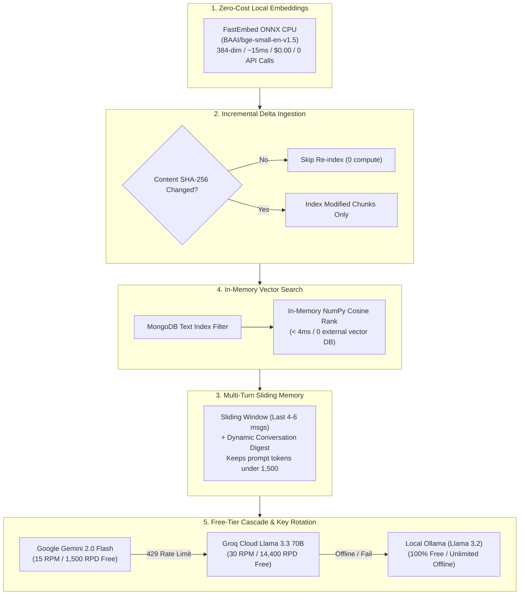
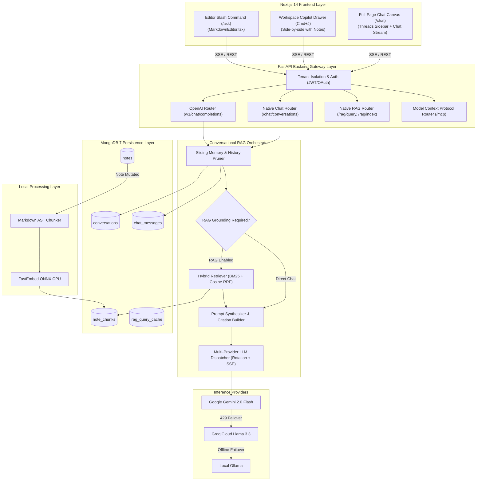
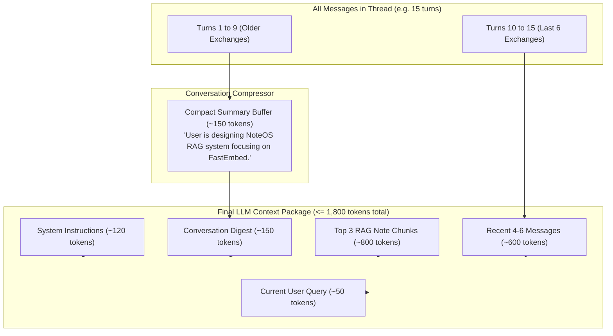
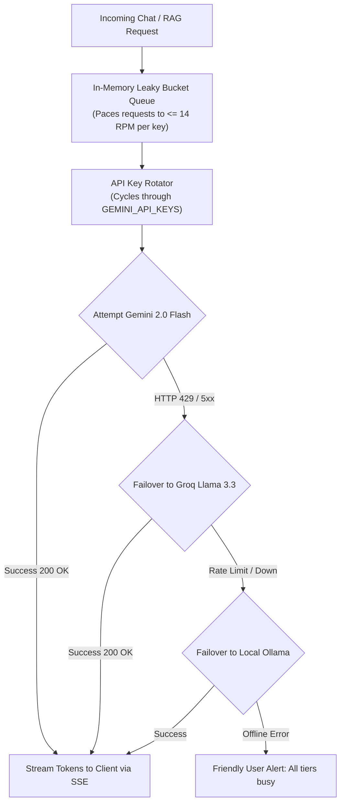
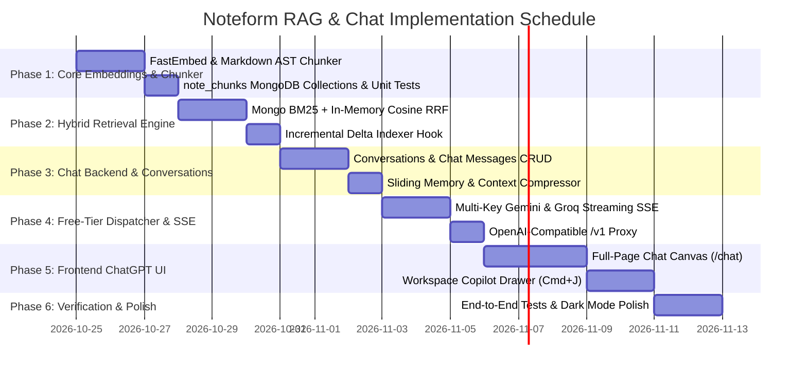

# Noteform AI Knowledge Platform: Unified RAG Engine & ChatGPT-Style Conversational Interface
## Architecture, Data Models, API Contracts, and Phased Implementation Plan

**Document Version:** 2.0.0  
**Target Platform:** Noteform (NoteOS) Workspace  
**Status:** Approved Master Architecture Plan  
**Author:** AI & Systems Architecture Team  

---

## 1. Executive Summary & Product Vision

Noteform (NoteOS) is evolving from a fast, private-by-default personal workspace into an **AI-native knowledge operating system**. Modern knowledge workers do not just want to search or read their notes—they want to **converse** with their accumulated thinking, synthesize answers across projects, generate new ideas based on past writing, and use their workspace like a personalized, private ChatGPT.

This master document combines two core systems into a unified architecture:
1. **The Ultra-Low-Cost RAG (Retrieval-Augmented Generation) Engine:** Zero-cost local dense embeddings (`FastEmbed`), incremental markdown chunking, hybrid BM25 + Vector retrieval, and free-tier LLM failover.
2. **The ChatGPT-Style Conversational Interface & Chat System:** Persistent conversation threads, multi-turn conversational memory, token-by-token Server-Sent Events (SSE) streaming, interactive source citations, `@note` explicit context mentions, and one-click "Save to Note" workflows.
3. **OpenAI & OpenAPI Compatible Server:** Standard `/v1/chat/completions` API so external tools (Cursor, Claude Desktop, Raycast, LibreChat, Obsidian) can query Noteform knowledge directly.

---

## 2. Core Architectural Principles & Cost-Minimization Philosophy

Running AI features on personal or self-hosted applications often encounters two deal-breakers: **unsustainable API costs** and **frequent rate limit errors (HTTP 429)**. Noteform solves this through deliberate architecture:



### Key Architectural Pillars:
1. **Zero-API-Cost Embedding Pipeline:** Uses `fastembed` (Qdrant's lightweight ONNX engine) running locally on CPU. Embeds chunks in ~15ms with **0 API tokens and $0.00 cost**.
2. **No Paid Vector Database Subscriptions:** Vector embeddings are stored directly in MongoDB 7. Active user vectors are evaluated in-memory using NumPy cosine similarity (< 4ms for 10,000 chunks).
3. **Multi-Key Round-Robin & 15 RPM Smoothing:** Supports `GEMINI_API_KEYS=key1,key2,key3` to scale free-tier throughput, backed by an in-memory leaky-bucket queue that prevents HTTP 429 errors.
4. **Sliding Memory Context Windows:** Multi-turn chats prune older exchanges and compress them into concise summaries, guaranteeing that conversation prompts stay strictly within free-tier token budgets.
5. **Failover Cascade:** Automatically cascades from Gemini 2.0 Flash to Groq Llama 3.3 to local Ollama if network or rate limits occur.

---

## 3. End-to-End System Architecture



---

## 4. ChatGPT-Style User Experience & Interface Design

Noteform provides **two seamless modalities** for conversation:
1. **Full-Page Chat Canvas (`/chat` route):** Immersive, focused ChatGPT-style experience with conversation sidebar, prompt history, and full-width markdown responses.
2. **Workspace Copilot Drawer (`Cmd+J` or top bar Sparkle icon):** Collapsible right-hand drawer that runs side-by-side with any active note document.

```
+--------------------------------------------------------------------------------------------------+
| NoteOS Topbar: [✦ NoteOS] [Search ⌘K] [Ask AI ⌘J]                        [☀️/🌙] [Avatar]        |
+--------------------------+-----------------------------------------------------------------------+
| CHATS SIDEBAR            | CONVERSATION CANVAS: "Q4 Roadmap & Technical Strategy"               |
|                          |                                                                       |
| [+ New Chat]             | [User]: What are our key deliverables for the RAG engine?            |
|                          |                                                                       |
| TODAY                    | [NoteOS Copilot]:                                                    |
| ✦ Q4 Roadmap Strategy    | Based on your notes in [[Sprint Planning]] and [[Architecture Docs]]:|
| ✦ Competitor Research    |                                                                       |
|                          | 1. **Zero-Cost Embeddings:** Utilizing FastEmbed ONNX on CPU.        |
| PREVIOUS 7 DAYS          | 2. **Hybrid Search:** Combining MongoDB BM25 with vector cosine.      |
| ✦ Database View Polish   | 3. **OpenAI Proxy:** Exposing `/v1/chat/completions` for Cursor.      |
| ✦ Google Sign-In Plan    |                                                                       |
|                          | ─────────────────────────────────────────────────────────────────    |
| [Settings / Model Select]| 📚 Sources Referenced (2):                                            |
| Current: Gemini Flash ▾  | [📄 Sprint Planning > Roadmap] [📄 Architecture Docs > Storage]        |
|                          | [Copy] [Regenerate] [＋ Save as Note]                                 |
|                          +-----------------------------------------------------------------------+
|                          | INPUT BOX:                                                            |
|                          | [ Ask about notes, mention @note, or brainstorm...             (RAG ✓)|
|                          | [⚡ Model: Gemini 2.0 Flash] [Paperclip: Attach Note] [↑ Send]         |
+--------------------------+-----------------------------------------------------------------------+
```

### 4.1 Chat UI Capabilities:
1. **Thread Management Sidebar:**
   - Grouped chronologically: *Today*, *Yesterday*, *Previous 7 Days*, *Previous 30 Days*.
   - Auto-generated conversation titles based on user's opening prompt.
   - Inline conversation actions: Rename, Pin to top (`★`), and Delete.
2. **Token-by-Token Streaming with SSE:**
   - Immediate feedback with smooth character-by-character text stream and pulsating cursor.
   - Dedicated "Stop Generating" button to interrupt generation and save tokens.
3. **Interactive Citation Badges & Pills:**
   - Inline citation badges (e.g. `[[Sprint Planning]]`).
   - Collapsible **"Sources Referenced (N)"** drawer below assistant responses showing excerpt snippets, similarity scores, and one-click navigation to open the source note.
4. **Explicit Note Mentions (`@note` / `[[note]]`):**
   - Typing `@` or `[[` in the chat input opens an autocomplete popover of workspace notes.
   - Allows users to force-scope an answer to a specific note or subpage.
5. **One-Click "Save as Note":**
   - Click **"＋ Save as Note"** on any assistant completion to immediately create a new Noteform document containing the synthesized answer and source citations.
6. **Grounding Toggle (`RAG ON/OFF`):**
   - Users can toggle between **Ground with Notes** (strict workspace retrieval) and **General Chat** (raw LLM generation).

---

## 5. Database Schema & Data Models

### 5.1 `conversations` Collection
Stores persistent conversation metadata, model choices, and scoping filters.

```typescript
interface ConversationDocument {
  _id: ObjectId;
  owner_id: ObjectId;                  // User isolation boundary
  title: string;                       // E.g., "Architecture Review & Next Steps"
  model: string;                       // E.g., "gemini-2.0-flash", "llama-3.3-70b"
  rag_enabled: boolean;                // Whether notes grounding is enabled
  rag_filters: {
    category?: string | null;          // Scope to a specific category (e.g., "Engineering")
    tags?: string[];                   // Scope to specific tags (e.g., ["urgent", "roadmap"])
    note_ids?: ObjectId[];             // Explicitly pinned source notes
  };
  is_pinned: boolean;                  // Pinned to top of sidebar
  message_count: number;               // Quick count
  summary?: string | null;             // Rolling conversation digest for context compression
  created_at: Date;
  updated_at: Date;
}
```

**Indexes:**
```python
db.conversations.create_index([("owner_id", 1), ("updated_at", -1)])
db.conversations.create_index([("owner_id", 1), ("is_pinned", -1), ("updated_at", -1)])
```

---

### 5.2 `chat_messages` Collection
Stores sequential dialogue turns with source citations and metadata.

```typescript
type MessageRole = "user" | "assistant" | "system";

interface CitationItem {
  note_id: ObjectId;
  title: string;
  heading_path: string[];
  snippet: string;
  similarity_score: number;
}

interface ChatMessageDocument {
  _id: ObjectId;
  conversation_id: ObjectId;           // Parent thread
  owner_id: ObjectId;                  // Tenant isolation guard
  role: MessageRole;                   // "user" | "assistant"
  content: string;                     // Raw markdown content
  citations: CitationItem[];           // RAG source citations (empty if non-RAG)
  model_used: string;                  // Exact model that generated response
  prompt_tokens?: number;              // Token tracking
  completion_tokens?: number;          // Token tracking
  latency_ms?: number;                 // Response time
  created_at: Date;
}
```

**Indexes:**
```python
db.chat_messages.create_index([("conversation_id", 1), ("created_at", 1)])
db.chat_messages.create_index([("owner_id", 1), ("created_at", -1)])
```

---

### 5.3 `note_chunks` Collection
Stores semantic segments of notes with dense 384-dimensional vector embeddings and hierarchy breadcrumbs.

```typescript
interface NoteChunkDocument {
  _id: ObjectId;
  owner_id: ObjectId;
  note_id: ObjectId;
  chunk_index: number;
  heading_path: string[];              // E.g., ["Backend Guide", "Database Setup"]
  title: string;                       // Title of source note
  text: string;                        // Paragraph or section content (250-350 tokens)
  token_count: number;
  vector: number[];                    // 384-dimensional float array from FastEmbed
  content_hash: string;                // SHA-256 of text for zero-cost diffing
  tags: string[];
  category: string;
  created_at: Date;
  updated_at: Date;
}
```

**Indexes:**
```python
db.note_chunks.create_index([("owner_id", 1), ("note_id", 1)])
db.note_chunks.create_index([("owner_id", 1), ("content_hash", 1)])
db.note_chunks.create_index([("owner_id", 1), ("category", 1)])
db.note_chunks.create_index([("owner_id", 1), ("tags", 1)])
db.note_chunks.create_index(
    [("title", "text"), ("text", "text"), ("heading_path", "text")],
    name="chunk_fulltext_search_idx"
)
```

---

## 6. Multi-Turn Conversation Memory & Token Budgeting

Sending unlimited prior messages into an LLM causes prompt token explosion, quickly exhausting free-tier RPM and TPM quotas. Noteform implements a **Hybrid Sliding Window with Dynamic Summarization**:



### Context Budget Breakdown:
| Context Section | Max Allowed Tokens | Purpose |
| :--- | :--- | :--- |
| **System Instruction** | ~120 tokens | Strict grounding & citation rules |
| **Workspace Notes Context** | ~800 tokens | Top 3–4 chunks from hybrid search |
| **Historical Thread Digest** | ~150 tokens | Rolling background context of older turns |
| **Sliding Window Messages** | ~600 tokens | Verbatim last 4–6 messages for immediate continuity |
| **User Query & Margins** | ~150 tokens | Current turn question |
| **TOTAL PROMPT BUDGET** | **<= 1,820 tokens** | **Comfortably below free-tier TPM limits** |

---

## 7. Fast In-Memory Hybrid Retrieval Engine

Noteform avoids cloud vector database bills by utilizing an optimized two-stage pipeline:

### Stage 1: Fast Candidate Pruning (MongoDB BM25)
When a query arrives, MongoDB executes a text match scoped to the user's workspace:
```python
query = {
    "owner_id": user["_id"],
    "$text": {"$search": search_terms}
}
```
This narrows down thousands of chunks to the top 30 candidate documents in **< 5ms**.

### Stage 2: Dense Cosine Similarity & Reciprocal Rank Fusion (RRF)
- The query is embedded using local `fastembed` in **~15ms**.
- Cosine similarities are computed in-memory across the candidate vectors using vectorized NumPy matrix multiplication:
  $$\text{cosine\_sim}(Q, V_i) = \frac{Q \cdot V_i}{\|Q\| \|V_i\|}$$
- Scores from both lexical BM25 rank ($r_{\text{lex}}$) and semantic dense rank ($r_{\text{dense}}$) are fused using standard RRF:
  $$\text{Score}(d) = \frac{1}{60 + r_{\text{lex}}(d)} + \frac{1}{60 + r_{\text{dense}}(d)}$$
- The top 3–5 highest-scoring chunks are passed to the synthesizer.

---

## 8. Multi-Provider Free-Tier Dispatcher & Rate-Limit Shield

To ensure Noteform runs smoothly on 100% free developer tiers without hitting HTTP 429 limits:



### Supported Providers Configuration (`.env`):
```dotenv
# Primary Free Tier: Google Gemini 2.0 Flash (Supports comma-separated keys for load balancing)
GEMINI_API_KEYS=AIzaSyA1...,AIzaSyB2...,AIzaSyC3...

# Secondary Free Tier: Groq Cloud (Ultra-fast Llama 3.3 70B & 8B)
GROQ_API_KEYS=gsk_abc1...,gsk_def2...

# Tertiary Offline Tier: Local Ollama (Zero internet, zero tokens)
OLLAMA_BASE_URL=http://localhost:11434
OLLAMA_MODEL=llama3.2:3b

# Default System Model
DEFAULT_AI_MODEL=gemini-2.0-flash
```

---

## 9. Comprehensive API Specification

### 9.1 Chat Conversations API (`/chat/conversations`)

#### `GET /chat/conversations`
List user's active conversations sorted by pinned status and updated date.
- **Query Params:** `limit` (int, default 30), `pinned` (bool)
- **Response:**
  ```json
  {
    "conversations": [
      {
        "id": "67123abc...",
        "title": "Q4 Roadmap Strategy",
        "model": "gemini-2.0-flash",
        "rag_enabled": true,
        "is_pinned": true,
        "message_count": 8,
        "updated_at": "2026-10-24T14:30:00Z"
      }
    ]
  }
  ```

#### `POST /chat/conversations`
Create a new conversation thread.
- **Payload:**
  ```json
  {
    "title": "New Chat",
    "model": "gemini-2.0-flash",
    "rag_enabled": true,
    "rag_filters": {
      "category": "Engineering",
      "tags": ["backend"]
    }
  }
  ```

#### `GET /chat/conversations/{id}`
Retrieve complete thread details and message history.
- **Response:**
  ```json
  {
    "conversation": { ... },
    "messages": [
      {
        "id": "67124def...",
        "role": "user",
        "content": "What is the launch date for Phase 2?",
        "created_at": "2026-10-24T14:31:00Z"
      },
      {
        "id": "67124def...",
        "role": "assistant",
        "content": "Phase 2 launches on November 15, 2026 according to [[Roadmap]].",
        "citations": [
          {
            "note_id": "507f1f...",
            "title": "Sprint Planning",
            "heading_path": ["Roadmap", "Milestones"],
            "snippet": "Phase 2 launch target: November 15, 2026."
          }
        ],
        "created_at": "2026-10-24T14:31:02Z"
      }
    ]
  }
  ```

#### `POST /chat/conversations/{id}/messages` (Streaming SSE Supported)
Append a user message and receive the streamed assistant response with citations.
- **Payload:**
  ```json
  {
    "content": "Summarize the key blockers in my engineering notes.",
    "stream": true,
    "rag_enabled": true
  }
  ```
- **SSE Stream Protocol:**
  ```http
  HTTP/1.1 200 OK
  Content-Type: text/event-stream
  Cache-Control: no-cache

  data: {"event": "citations", "citations": [{"note_id": "507...", "title": "Backend Sprint"}]}
  data: {"event": "delta", "text": "Based"}
  data: {"event": "delta", "text": " on your"}
  data: {"event": "delta", "text": " notes..."}
  data: {"event": "done", "message_id": "67124def...", "total_tokens": 142}
  ```

#### `POST /chat/conversations/{id}/export-note`
Converts conversation content into a permanent Noteform note document.
- **Payload:** `{ "message_id": "optional_specific_message_id", "title": "Optional Note Title" }`
- **Response:** `{ "note": { "id": "...", "title": "...", "content": "..." } }`

---

### 9.2 OpenAI-Compatible API (`/v1`)

Provides drop-in compatibility for Cursor, Claude Desktop, Raycast, and OpenAI SDKs.

- **`POST /v1/chat/completions`**: Supports standard OpenAI payload with custom `rag_enabled` and `rag_filters` options. Supports standard SSE streaming chunks.
- **`GET /v1/models`**: Lists available Noteform virtual models:
  - `noteform-rag` (Default: Gemini 2.0 Flash + RAG)
  - `noteform-rag-groq` (Groq Llama 3.3 + RAG)
  - `noteform-rag-local` (Ollama + RAG)
  - `noteform-direct` (Fast direct LLM without notes grounding)

---

### 9.3 MCP Protocol Extensions (`POST /mcp`)

Extends Noteform's Model Context Protocol server with 3 native tools:
1. `rag_search(query: str, limit: int = 5)`: Semantic search over notes.
2. `ask_workspace(question: str)`: End-to-end grounded answer generation.
3. `list_chat_conversations()`: Allows external AI agents to read prior chat session contexts.

---

## 10. Frontend Architecture & Design Specification

### 10.1 UI Component Architecture

```
frontend/app/
├── chat/
│   └── page.tsx                    // Full-page ChatGPT canvas
├── components/
│   ├── chat/
│   │   ├── ChatSidebar.tsx         // Conversation thread list with grouping
│   │   ├── ChatMessageList.tsx     // Message turns with markdown & code styling
│   │   ├── ChatMessageItem.tsx     // Individual bubble with copy & save actions
│   │   ├── ChatInputBox.tsx        // Rich textarea with @note autocomplete & RAG switch
│   │   ├── CitationCard.tsx        // Clickable citation pill with hover preview
│   │   └── ModelSelectorModal.tsx  // Model switcher (Gemini, Groq, Ollama)
│   ├── AiCopilotDrawer.tsx         // Slide-out Copilot drawer for main workspace
│   └── MarkdownEditor.tsx          // Enhanced with /ask inline command
```

### 10.2 Aesthetic & Theme Harmony
- Designed according to Noteform's sleek Notion-inspired Vanilla CSS design system.
- Full Light Mode and Dark Mode support:
  - **Light Mode:** Crisp borders (`rgba(55, 53, 47, 0.09)`), subtle cream backgrounds (`#f7f7f5`), and vibrant accent blue (`#2383e2`).
  - **Dark Mode:** Deep slate canvas (`#191919`), sidebar background (`#202020`), soft citation pills (`rgba(35, 131, 226, 0.18)`), and white high-contrast text (`rgba(255, 255, 255, 0.9)`).
- Code blocks rendered with language badges and one-click copy buttons.

---

## 11. Security, Multi-Tenant Privacy & Google-Auth Guard

1. **Mandatory Tenant Scoping:** Every database query, vector search, and conversation lookup enforces `{"owner_id": current_user["_id"]}`. Users can never query or view other users' conversations or chunks.
2. **Shared Note Security:** Chunks belonging to shared notes check the Google authentication status of the collaborator before inclusion in RAG context.
3. **No Training Guarantee:** External calls to Gemini and Groq pass explicit headers disabling model training on user data.
4. **Offline Local Air-Gap:** Setting `DEFAULT_AI_MODEL=ollama` guarantees that 100% of embeddings, retrieval, and generation remain on the user's local hardware.

---

## 12. Implementation Roadmap & Phased Delivery



### Detailed Phase Breakdown:

#### Phase 1: Embedding & Ingestion Core (Days 1–3)
- [ ] Install `fastembed==0.4.1` and `numpy` in `backend/requirements.txt`.
- [ ] Create `backend/app/rag/chunker.py` (Markdown AST parser, table-safe, breadcrumb header hierarchy).
- [ ] Create `backend/app/rag/embedder.py` (FastEmbed wrapper with 384-dim ONNX model).
- [ ] Create `note_chunks` collection and indexes in `backend/app/database.py`.
- [ ] Unit tests for chunking integrity and SHA-256 hash stability.

#### Phase 2: Hybrid Retrieval & Indexing Hooks (Days 4–6)
- [ ] Implement `backend/app/rag/retriever.py`:
  - MongoDB BM25 text candidate filter.
  - In-memory NumPy cosine ranking.
  - Reciprocal Rank Fusion (RRF) algorithm.
- [ ] Connect note mutations (`POST /notes`, `PATCH /notes/{id}`, `DELETE /notes/{id}`) to background delta re-indexing.
- [ ] Benchmark retrieval latency (target: < 20ms).

#### Phase 3: Conversational Memory & Chat Database (Days 7–9)
- [ ] Create `conversations` and `chat_messages` collections in `backend/app/database.py`.
- [ ] Implement `backend/app/chat/conversations.py` (CRUD for threads, auto-title generation).
- [ ] Implement `backend/app/chat/memory.py` (Sliding window + dynamic history compressor).

#### Phase 4: Free-Tier LLM Dispatcher & OpenAI Proxy (Days 10–12)
- [ ] Implement `backend/app/rag/providers.py`:
  - Multi-key rotation and token bucket for Google Gemini 2.0 Flash.
  - Groq Cloud Llama 3.3 failover client.
  - Local Ollama client.
- [ ] Build SSE streaming response generator with citation payloads.
- [ ] Implement `/v1/chat/completions` and `/v1/models` in `backend/app/rag/openai_router.py`.

#### Phase 5: Frontend ChatGPT Interface & Copilot Drawer (Days 13–17)
- [ ] Build `/chat` full-page route with thread sidebar, message stream, and model selector.
- [ ] Build interactive citation pills and source preview cards.
- [ ] Implement `@note` autocomplete in chat textarea.
- [ ] Build "＋ Save to Note" feature.
- [ ] Build Workspace Copilot Drawer (`Cmd+J`) in `frontend/app/page.tsx`.

#### Phase 6: Polish & Verification (Days 18–19)
- [ ] Verify light/dark mode visual contrast in `frontend/app/globals.css`.
- [ ] Test integration with Cursor and Claude Desktop MCP.
- [ ] Full automated test suite for chat persistence, RAG grounding, and streaming.

---

## 13. Summary Matrix: Traditional vs. Noteform Architecture

| Capability | Traditional Cloud Setup | Noteform Unified Architecture |
| :--- | :--- | :--- |
| **Embeddings Cost** | $0.02 – $0.10 / 1M tokens | **$0.00 (Local FastEmbed ONNX)** |
| **Vector DB Cost** | $70 / month (Pinecone/Weaviate) | **$0.00 (MongoDB + In-Memory NumPy)** |
| **LLM Inference Cost** | $5.00 – $20.00 / 1M tokens | **$0.00 (Gemini 2.0 Flash / Groq Free Tiers)** |
| **Daily Free Quota** | None | **1,500 – 14,400 queries / day free** |
| **Chat Memory** | Unlimited raw turns (token blowout) | **Sliding window + summary (<= 1.8k tokens)** |
| **Client Support** | Web only | **Web, Copilot Drawer, Cursor, MCP, OpenAI API** |
| **Offline Privacy** | Cloud dependent | **100% Offline with Ollama & FastEmbed** |

---

## 14. Approval & Next Steps

This plan provides a complete, production-grade roadmap to build a **world-class AI workspace copilot and ChatGPT interface** directly inside Noteform while maintaining zero hosting cost bloat.

To proceed:
1. Review the architecture and milestones above.
2. Begin Phase 1 implementation (FastEmbed setup, AST chunking, and database collections).
